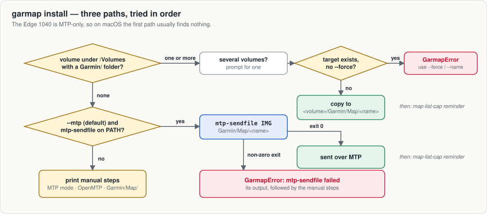

# Getting the map onto the Edge

The Edge 1040 speaks MTP, not USB mass storage. macOS does not mount MTP devices, so
the device never appears in Finder. `garmap install` tries three paths in order.

| Path | When it applies | What happens |
|---|---|---|
| Mounted volume | a volume under `/Volumes` has a `Garmin/` folder (mass-storage units, SD cards) | the file is copied to `Garmin/Map/` |
| libmtp | no volume, and `mtp-sendfile` is on `PATH` | `mtp-sendfile IMG Garmin/Map/<name>` |
| Manual | neither | garmap prints the steps below |

Volume detection only looks in `/Volumes`, so the first path is macOS-only at present
(finding [L6](../review/findings.md#l6-install-path-is-macos-only-and-loosely-matched)).

## Copying by hand

1. Quit Garmin Express **and** stop its background service in Activity Monitor. Only
   one program can talk to the Edge over USB at a time.
2. Power the Edge off completely.
3. Hold the lap button (bottom left) while connecting the USB cable, until the screen
   shows `usb mtp mode`. Large transfers routinely stall without this.
4. Open the device in an MTP client. [OpenMTP](https://openmtp.ganeshrvel.com/) is the
   most reliable on macOS.
5. Copy the `.img` into `Garmin/Map/` on the device.

## Device details

- **Firmware 9.2.9 or newer** is needed for converted maps to render.
- **The map list has a cap that is independent of free space.** If the new map does not
  appear under *Map Information*, delete preinstalled maps you do not use.
- **Unique filenames in `Garmin/Map/`.** Do not use a single `gmapsupp.img` at the
  root.
- **Unique family ids.** Give each map its own `--name` at build time; see
  [Choosing a name](workflow.md#choosing-a-name).
