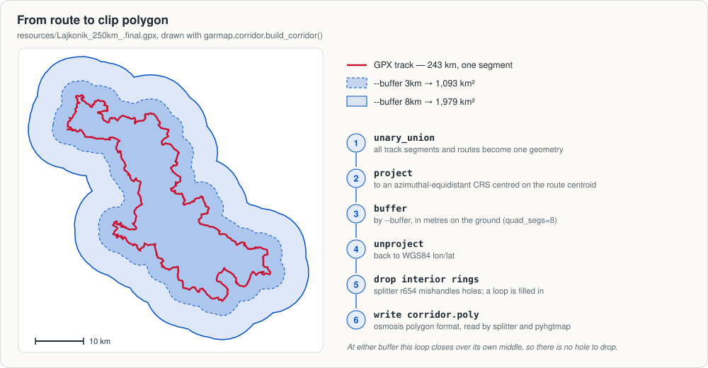

# Preview, build, install

## 1. Preview

```console
$ uv run garmap preview tour.gpx --buffer 8km
```

`preview` reads the route, builds the corridor, picks the Geofabrik extracts and asks
the server how big each one is. It downloads no map data. It writes two files next to
where you ran it and opens the HTML in a browser:

- `tour-preview.html`: a Leaflet map with the route (red), the corridor (blue) and the
  chosen extracts (grey, dashed), plus a legend with download sizes;
- `tour-preview.geojson`: the same three layers as data.

Read three things off it:

1. **Does the corridor cover the detours you might take?** If not, widen `--buffer`.
2. **Which extracts were chosen?** A corridor that crosses a border pulls in a second
   extract. That is usually what decides the download size.
3. **The total.** Note that the printed total currently includes extracts you already
   have cached (finding [L3](../review/findings.md#l3-preview-total-counts-cached-extracts)).

## 2. Build

```console
$ uv run garmap build tour.gpx --buffer 8km --contours --name "Tatras 2026" -o tatras.img
```

The build prints one `==>` line per stage:

```text
==> Checking tools
==> Reading route
==> Choosing OSM extracts
==> Downloading OSM data
==> Clipping and splitting into tiles
==> Generating 10 m contour lines
==> Compiling map
```

and ends with a report: output path, map name, family id, size, and tile count.

### Choosing the buffer

`--buffer` is the main size dial. The corridor area, and with it the map size, grows
roughly linearly with the buffer once the buffer is small relative to the route's
extent. For the Lajkonik sample route (243 km):

| `--buffer` | Corridor area |
|---|---|
| 3 km | 1,093 km² |
| 8 km | 1,979 km² |



### Choosing a name

`--name` sets the name shown on the device **and** determines the map's family id
(`2000 + crc32(name) % 63000`). Two maps on one device with the same family id hide or
corrupt each other. Use one distinct name per trip. Without `--name`, the name comes
from the first GPX filename, so two files called `route.gpx` in different folders
produce clashing maps.

### Contours and relief

- `--contours` adds contour lines labelled in metres. `--contour-step` sets the
  interval (default 10 m). On flat routes 20 m is more readable.
- `--dem` embeds elevation data for shaded relief. It requires `--contours`. See
  finding [H3](../review/findings.md#h3---dem-points-mkgmap-at-the-wrong-directory-level)
  before relying on it.

### Several routes in one map

`build` and `preview` accept several GPX files. The corridor is the union of their
buffers. This is meant for the adjoining days of one tour. Two routes far apart force the
extract selection up to a much larger region.

## 3. Install

```console
$ uv run garmap install tatras.img
```

See [Getting the map onto the Edge](device.md).

## The sample routes

`resources/` holds two real routes:

| File | Length | Elevation | Suggested command |
|---|---|---|---|
| `Lajkonik_250km_.final.gpx` | 243 km | 242–762 m | `--buffer 8km --contours` |
| `Sudovia GRVL KLASYK 20-05-26.gpx` | 182 km | 123–281 m | `--buffer 6km --contours --contour-step 20` |

Quote the second path: it contains spaces.
