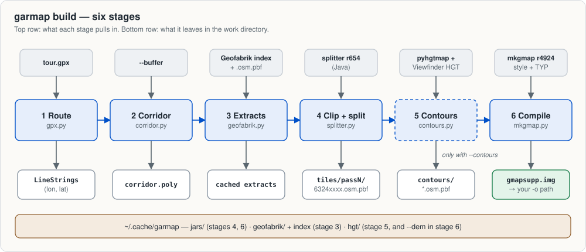
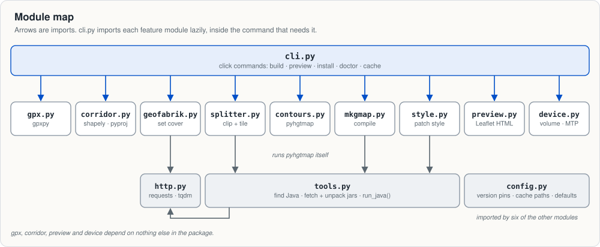

# Architecture

garmap is a pipeline of six stages behind a click command-line interface. Each stage is
one module with a small public surface, and each wraps one external tool or library.



## Modules



| Module | Lines | Responsibility |
|---|---|---|
| `cli.py` | 537 | click commands; the only module that prints progress |
| `config.py` | 66 | pinned tool versions, cache paths, defaults, map-id bases |
| `gpx.py` | 61 | GPX tracks and routes to shapely `LineString`s |
| `corridor.py` | 80 | buffer in metres, strip holes, write `.poly` |
| `geofabrik.py` | 213 | region index, greedy set cover, extract download |
| `http.py` | 99 | cached download with `.part` files and ETag revalidation |
| `tools.py` | 207 | find Java, fetch and unpack jars, run a Java tool |
| `splitter.py` | 125 | one splitter pass per extract |
| `contours.py` | 112 | run pyhgtmap |
| `style.py` | 82 | copy and patch mkgmap's default style |
| `mkgmap.py` | 186 | build the args file, run mkgmap, check the result |
| `preview.py` | 119 | GeoJSON and Leaflet HTML |
| `device.py` | 119 | mounted volume, MTP, manual instructions |

## Conventions that hold across the code

- **One expected-error type.** Every anticipated failure raises `GarmapError`
  (`__init__.py`). `cli.entrypoint()` prints it as `error: ...` and exits 1. Anything
  else is a bug and surfaces as a traceback.
- **Lazy imports.** `cli.py` imports shapely, pyproj and the feature modules inside the
  command functions, so `garmap --help` and `garmap cache list` start without loading
  the geometry stack.
- **Argument builders are pure.** `splitter.build_args`, `contours.build_args` and
  `mkgmap.build_args` return an argv list without running anything. That is what makes
  the wrappers unit-testable offline.
- **Verify by artefact, not by exit code.** mkgmap exits 0 even when it compiles
  nothing, so `mkgmap.compile_map` counts the `NNNNNNNN.img` tile files it finds.
  splitter and pyhgtmap are checked the same way.
- **Comments record the reason.** Most non-obvious choices carry a comment saying what
  went wrong with the obvious alternative. The chapters that follow lean on those.

## Control flow of `garmap build`

```text
build()
  check_java()
  _corridor_for()            gpx.read_all -> corridor.build_corridor
                             -> geofabrik.load_index -> select_regions
  write_poly()               <work>/corridor.poly
  geofabrik.fetch() x N      -> http.download
  splitter.split()           one run_java per extract
  contours.generate()        only with --contours
  style.materialise()        <work>/cycle/
  mkgmap.compile_map()       run_java, then move gmapsupp.img to -o
  finally: remove the work dir unless it was given or --keep-work
```

`preview` shares the first block (`_corridor_for`) and then writes HTML instead of
downloading.

## External processes

| Process | Started by | Working directory | Output handling |
|---|---|---|---|
| `java -Xmx<heap>m -jar splitter.jar ...` | `tools.run_java` | `<work>/tiles/passN` | captured; streamed with `-v`; last 25 lines shown on failure |
| `pyhgtmap ...` | `contours.generate` | `<work>/contours` | captured unless `-v`; last 15 lines shown on failure |
| `java -Xmx<heap>m -jar mkgmap.jar ...` | `tools.run_java` | `<work>/out` | as for splitter |
| `mtp-sendfile IMG REMOTE` | `device.install_via_mtp` | current directory | captured |

The Java heap is half of physical memory, clamped to 1–12 GB (`tools.heap_mb`). The
comment there explains why not more: both tools are I/O-heavy, and starving the page
cache slows them down.
