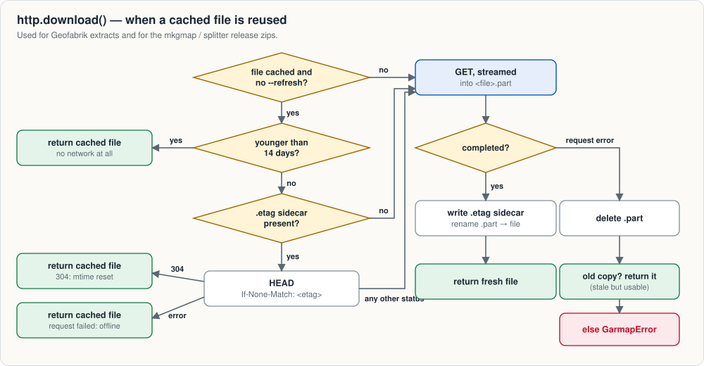

# Downloads and the cache

`http.download(url, destination)` is used for the two kinds of large download: Geofabrik
extracts and the mkgmap and splitter release zips.

## Rules

- **Fresh enough is good enough.** A cached file younger than 14 days
  (`STALE_AFTER_SECONDS`) is returned without any network request. Geofabrik rebuilds
  daily, but a one-day-fresher map is not worth several hundred megabytes.
- **Older files are revalidated, not re-downloaded.** If an `.etag` sidecar exists, a
  `HEAD` request with `If-None-Match` is sent. A `304` resets the file's mtime, which
  restarts the 14-day clock.
- **Offline is not an error.** If the revalidation request fails, or the download
  fails and an old copy exists, the old copy is returned.
- **No truncated cache entries.** Data is streamed to `<file>.part` and renamed into
  place only when the response has been read completely.
- **`--refresh`** skips all of the above and downloads again.

## What is not checked

The content of a download is never verified. There is no checksum for the tool zips and
no comparison against the `.md5` files Geofabrik publishes. See finding
[M1](../review/findings.md#m1-downloaded-jars-are-executed-without-an-integrity-check).

## The tool cache (`tools.jar_path`)

A tool is "installed" when `~/.cache/garmap/jars/<tool>-r<version>/<tool>.jar` exists.
Otherwise the release zip is downloaded, unpacked into a staging directory, and the
directory containing the jar is moved into place. The whole release directory is kept:
mkgmap's manifest refers to a sibling `lib/` directory.

A zip that fails to open is deleted so that the next run downloads it again.

## Other cached data

| Data | Written by | Freshness rule |
|---|---|---|
| Geofabrik index | `geofabrik.load_index` | re-fetched after 7 days; stale copy used if the fetch fails |
| HGT elevation tiles | pyhgtmap, into `hgt/VIEW1/` and `hgt/VIEW3/` | never refreshed |
