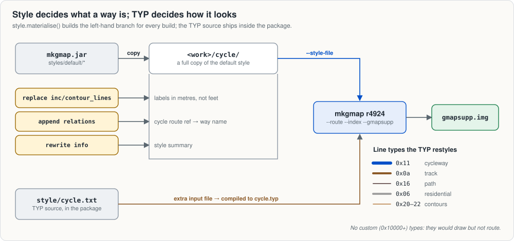

# Compile, style and TYP

## Style and TYP are separate layers



A mkgmap **style** decides what each OSM element becomes: which Garmin type, at which
zoom levels, with which routing class and speed. A **TYP file** decides how each Garmin
type is drawn: colour, width, border.

garmap puts its cycling emphasis in the TYP and leaves the style's type assignments
alone. The reason is routing. Garmin devices only route over a fixed set of standard
line types. Giving cycleways a custom type (`0x10000` and above) would make them
drawable in any colour, and unroutable.

## The style: copied and patched (`style.py`)

Writing a whole style would mean re-implementing the default style's access, address
and road-speed logic, and keeping it in sync with every mkgmap release. Instead,
`style.materialise` copies `styles/default/` out of the pinned `mkgmap.jar` into
`<work>/cycle/` and changes three files:

| File | Change | Effect |
|---|---|---|
| `inc/contour_lines` | replaced | contour labels in metres |
| `relations` | rule appended | signed cycle-route reference added to way names |
| `info` | rewritten | style summary |

Both patches fail loudly if the default style's layout changes: a missing `styles/default/`
or a missing `inc/contour_lines` raises a `GarmapError` that says the patch needs
updating.

### The cycle-route rule

```text
type=route & (route=bicycle | route=mtb) & (ref=* | name=*)
{
    set garmap:cycleref='${ref}' | '${name}';
    apply {
        set name='$(name) (${garmap:cycleref})' | '(${garmap:cycleref})';
    }
}
```

For every bicycle or MTB route relation, the rule takes the route's `ref` (or its
`name`), then rewrites the `name` of each member way to `Way name (REF)`. Inside
`apply`, `$(name)` reads the member way's tag and `${...}` reads the relation's. A way
on several routes accumulates them: `Lane (EV4) (R-12)`. The rule assigns no Garmin
type, so appending it cannot shadow an existing rule.

The result is that the Edge shows which signed route you are on, on the map and in the
turn list.

## The TYP (`style/cycle.txt`)

| Type | Feature | Colour | Width |
|---|---|---|---|
| `0x11` | cycleway | blue `#0050C8`, white border | 6 |
| `0x0a` | track | brown `#8C5A28`, pale border | 4 |
| `0x16` | path, footway | grey `#786464` | 2 |
| `0x06` | residential street | white, grey border | 4 |
| `0x20` | minor contour | `#C89664`, no label | 1 |
| `0x21` | medium contour | `#B4783C` | 1 |
| `0x22` | major contour | `#96501E` | 2 |

Points of interest are not overridden. The default style already emits drinking water,
bike shops, cafés, toilets and stations, and Garmin's built-in icons are used.

mkgmap has no `--typ-file` option. The TYP source is passed as one more input file and
mkgmap compiles it. Its family id is filled in from `--family-id`.

## The mkgmap command (`mkgmap.build_args`)

| Group | Options |
|---|---|
| Routing | `--route --drive-on=<side> --link-pois-to-ways --add-pois-to-areas --process-destination --process-exits` |
| Search | `--index --housenumbers --location-autofill=is_in,nearest` |
| Rendering | `--style-file=<work>/cycle` |
| Identity | `--family-id=<derived> --product-id=1 --family-name --series-name --description` (all the map name), `--area-name=garmap --overview-mapname=overview` |
| Output | `--output-dir=<work>/out --gmapsupp --max-jobs` |
| Optional | `--bounds=<dir>`, `--dem=<dir> --dem-dists=3312,13248`, `--generate-sea=multipolygon,extend-sea-sectors,close-gaps=6000,floodblocker` |
| Inputs | `--read-config=<work>/out/mkgmap.args`, then the TYP source |

### Family id

```python
2000 + (zlib.crc32(map_name.encode("utf-8")) % 63000)
```

The id is stable for a given name, so rebuilding a map replaces it cleanly on the
device. Different names almost always give different ids. The range avoids the low ids
Garmin uses.

### Result checks

`compile_map` treats mkgmap's exit code as insufficient:

1. `gmapsupp.img` must exist;
2. at least one `NNNNNNNN.img` tile must exist in the output directory. mkgmap exits 0
   and writes a header-only `gmapsupp.img` when it rejects an option.

Only then is `gmapsupp.img` moved to the `-o` path. `shutil.move` is used because the
work directory is often on a different filesystem.
