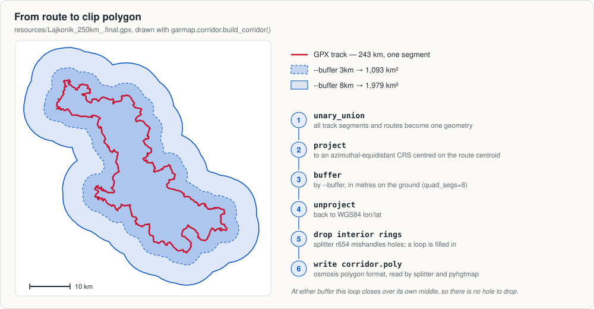

# Route and corridor

## Reading the route (`gpx.py`)

`read_gpx` takes every `<trkseg>` of every `<trk>`, and every `<rte>`, and turns each
into a `LineString` of `(lon, lat)` pairs. Three details:

- Consecutive duplicate points are dropped, so a recorder that stood still does not
  produce zero-length segments.
- A segment with fewer than two distinct points is skipped.
- Waypoints (`<wpt>`) are ignored. A set of unordered points does not define a corridor.

A file with no usable geometry raises a `GarmapError` that names the file and says what
is needed. Parse errors from gpxpy are wrapped the same way.

## Building the corridor (`corridor.py`)

The diagram is drawn from the real sample route by `docs/diagrams.py`, using
`build_corridor` itself.

### Why a local projection

Buffering in degrees would give a corridor that is too narrow east–west by a factor of
`cos(latitude)`: about 35 % too narrow at 50° N. garmap projects to an azimuthal
equidistant CRS centred on the route's centroid, buffers there in metres, and projects
back. For a corridor a few hundred kilometres across, the distortion of that projection
is far below the buffer width.

Limits worth knowing:

- Several GPX files that are thousands of kilometres apart share one centroid, so the
  buffer distance drifts away from the true value at the far ends.
- A route that crosses the antimeridian is not handled.

### Why holes are removed

A loop route with a small buffer produces a ring: a polygon with a hole in the middle.
The docstring of `build_corridor` records that splitter r654 does not handle holes in a
`.poly` file and silently drops data. garmap therefore keeps only the exterior ring of
each part (`corridor.py:47`).

The cost is a larger map for big loops with narrow buffers, because the whole interior
is included. The sample routes are not affected: at 3 km and at 8 km the Lajkonik
corridor already closes over its own middle.

### The `.poly` file

`write_poly` emits the osmosis polygon format: a name line, then one numbered section
per polygon with `lon lat` pairs in scientific notation, each closed by `END`, and a
final `END`. Both splitter (`--polygon-file`) and pyhgtmap (`--polygon`) read it. This
single file is what lets garmap clip without depending on osmium or osmconvert.

`area_km2` projects the corridor the same way and reports its area. The CLI prints it so
that the effect of `--buffer` is visible before anything is downloaded.
