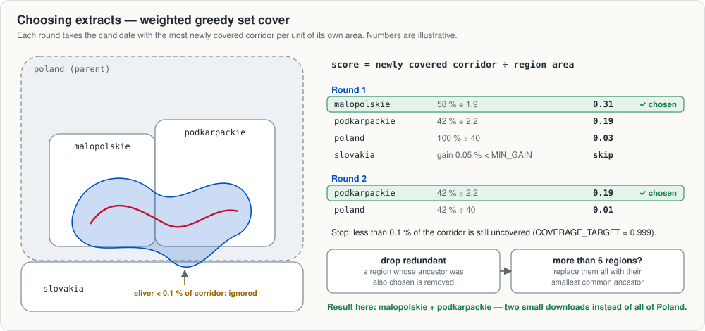

# Choosing extracts

Geofabrik publishes OpenStreetMap extracts as a tree: continents, countries, and for
some countries, subdivisions. Its index (`index-v1.json`) is a GeoJSON file with one
feature per extract, giving an id, a parent id, a boundary polygon and a download URL.

garmap has to pick a set of extracts that covers the corridor while downloading as
little as possible. A Tatras route should fetch `malopolskie` and `slovakia`, not
`europe`.

## The algorithm (`geofabrik.select_regions`)

1. **Candidates.** Every region whose polygon intersects the corridor.
2. **Greedy rounds.** For each candidate compute `gain`, the area of still-uncovered
   corridor it would cover. Skip candidates whose gain is under 0.1 % of the corridor
   (`MIN_GAIN`). Choose the candidate with the highest `gain / region.area`. Ties go
   to the smaller region. Subtract its polygon from the uncovered remainder.
3. **Stop** when less than 0.1 % of the corridor is uncovered
   (`COVERAGE_TARGET = 0.999`) or no candidate clears `MIN_GAIN`.
4. **Fallback.** If nothing was chosen, take the smallest region that touches the
   corridor.
5. **Drop redundant regions.** If a region and one of its ancestors were both chosen,
   the descendant is removed, so the same OSM elements are not fed in twice.
6. **Collapse.** If more than six regions remain (`MAX_REGIONS`), replace them with
   their smallest common ancestor, if they have one.

### Why this scoring works

Region area, in square degrees, stands in for download size. Dividing gain by area
means a small subdivision that covers most of the corridor beats the country that
contains it, and the country beats the continent. No knowledge of the tree's depth is
needed during the greedy rounds.

`MIN_GAIN` handles a common case: the buffer spills a few hundred metres over a border.
Without the threshold, that sliver would add a whole second country to the download.

### What it does not guarantee

- Greedy set cover is not optimal. For the shapes involved (a thin corridor over a few
  convex-ish regions) it is rarely far off.
- Square degrees shrink toward the poles relative to real area, and area is only a
  proxy for file size. A small dense region can be a larger download than a large empty
  one.
- The collapse in step 6 can jump to a very large parent without any message. See
  finding [L7](../review/findings.md#l7-_common_ancestor-docstring-and-the-silent-collapse).

## Coverage warning

After selection the CLI computes `coverage_fraction`, the share of the corridor inside
the chosen regions, and warns if it is under 99.9 %. Coastal routes trigger this
legitimately: the part of the buffer over the sea is in no extract.

## The index cache

`load_index` keeps the index at `~/.cache/garmap/geofabrik-index-v1.json` for seven
days. If a refresh fails and an old copy exists, the old copy is used. Region names are
cleaned of the HTML that Geofabrik embeds in some of them (`clean_name`).

Two weaknesses are covered in the review: a corrupt index file is not recovered from
([M3](../review/findings.md#m3-a-corrupt-index-cache-cannot-be-repaired-from-the-cli)),
and extract files are cached under a name that is not unique
([H2](../review/findings.md#h2-extract-cache-filenames-collide)).
