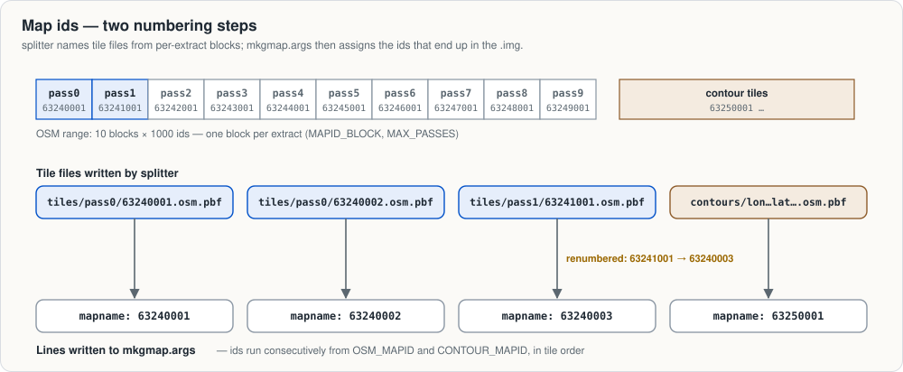

# Clip and split

splitter does two jobs in one run: it clips an extract to the corridor
(`--polygon-file`) and it cuts the result into tiles of at most `--max-nodes` nodes
each. mkgmap needs tiles because a single Garmin sub-map has a size limit.

## Arguments

`splitter.build_args` produces:

```text
--polygon-file=<work>/corridor.poly
--output-dir=<work>/tiles/passN
--output=pbf
--max-nodes=1400000
--mapid=<block start>
--keep-complete=true
--description=garmap
<extract.osm.pbf>
```

`--keep-complete=true` keeps ways and relations whole when they cross a tile edge.
Without it, routing breaks at tile boundaries.

## One pass per extract

When the corridor needs two extracts, the obvious approach is to pass both to one
splitter run. splitter refuses:

```text
Error: Node ids are not sorted. Use e.g. osmosis to sort the input data.
This is not supported with keep-complete=true or --problem-list
```

Each Geofabrik extract is sorted by node id internally, but two of them concatenated
are not. The module docstring lists the alternatives and why they were rejected:

| Alternative | Why not |
|---|---|
| Merge the extracts first | needs osmosis or osmium, the dependency garmap exists to avoid |
| Drop `--keep-complete` | truncates ways and relations at tile edges, which damages routing |
| **One pass per extract** (chosen) | keeps both properties; duplicates a strip of data where extracts overlap |

Each pass writes into its own directory, because splitter always writes `areas.list`,
`template.args` and `densities-out.txt` under fixed names.

The trade-off deserves a real-world check: whether the Edge routes cleanly across the
seam between tiles that came from different extracts. See finding
[M5](../review/findings.md#m5-routing-across-the-seam-between-extracts-is-untested).

## Map ids

Every tile in a Garmin map set needs a unique 8-digit id.



There are two numbering steps, and only the second one reaches the final image.

1. **splitter** is given `--mapid=63240001 + N × 1000` for pass *N*. It names its
   output files from that number upward. Ten blocks fit before the contour range starts
   at `63250001`, so at most ten extracts are accepted, and a pass that yields more
   than 1000 tiles is rejected.
2. **`mkgmap._args_file`** lists every tile with an explicit `mapname:`. OSM tiles are
   numbered consecutively from `63240001` in list order, and contour tiles
   consecutively from `63250001`.

So the per-pass blocks only keep the *file names* distinct between passes. The ids in
the map are the consecutive ones from step 2.

## Checks

`split` raises a `GarmapError` if there are no extracts, too many extracts, too many
tiles in one pass, or no tiles at all. The last message points the user at
`garmap preview`.

Tiles are found by globbing the pass directory for `<digits>.osm.pbf`. That glob also
finds tiles left by an earlier build in the same directory, which is finding
[H1](../review/findings.md#h1-a-reused---work-dir-leaks-old-tiles-into-the-new-map).
