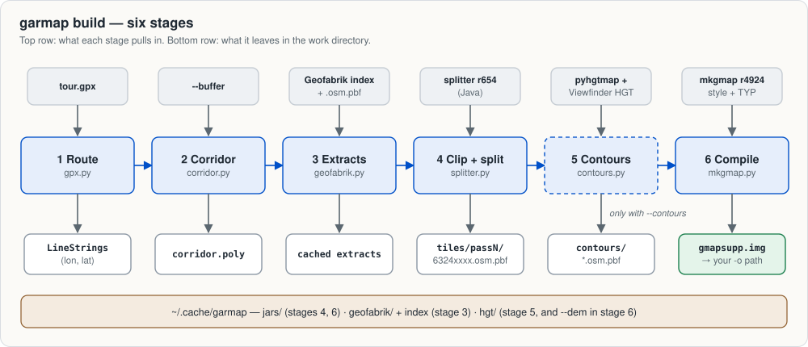

# garmap

garmap builds a small, routable, cycling-tuned Garmin `.img` map that covers one GPX
route and a strip of land either side of it. It is sized to sit next to the stock maps on
an Edge 1040.

```console
$ garmap preview tour.gpx --buffer 15km          # check coverage before downloading
$ garmap build tour.gpx --buffer 15km --contours -o alps-tour.img
$ garmap install alps-tour.img
```

garmap does not build the map itself. It orchestrates four upstream pieces and caches
what they need:

| Piece | Role | Where it comes from |
|---|---|---|
| [Geofabrik](https://download.geofabrik.de/) extracts | OpenStreetMap data | downloaded per region |
| [splitter](https://www.mkgmap.org.uk/) r654 | clips to the corridor, cuts tiles | pinned release zip |
| [mkgmap](https://www.mkgmap.org.uk/) r4924 | compiles tiles into a Garmin image | pinned release zip |
| [pyhgtmap](https://pypi.org/project/pyhgtmap/) | contour lines (optional) | Python extra |



## What is in this book

- **User guide**: installing, the three-command workflow, every option, and the
  device-side details that cost people an hour each.
- **How it works**: one chapter per pipeline stage, with the reasoning behind the
  non-obvious choices.
- **Code review**: a review of the codebase at version 0.1.0, with 21 findings ranked
  by severity, what was reproduced and what was not, and a suggested order of work.

## Scope of the review

The review covers everything in `src/garmap/` (about 2,000 lines of Python plus the
style and TYP sources), the test suite, and the project configuration. The Slidev deck
in `slides/` was read for consistency with the code but is not reviewed in depth.

The unit tests were run (84 pass). A full `garmap build` was **not** run: the
environment the review was done in could not reach `download.geofabrik.de` or
`mkgmap.org.uk`. Findings that depend on mkgmap's or splitter's runtime behaviour are
marked as unverified where they appear.
